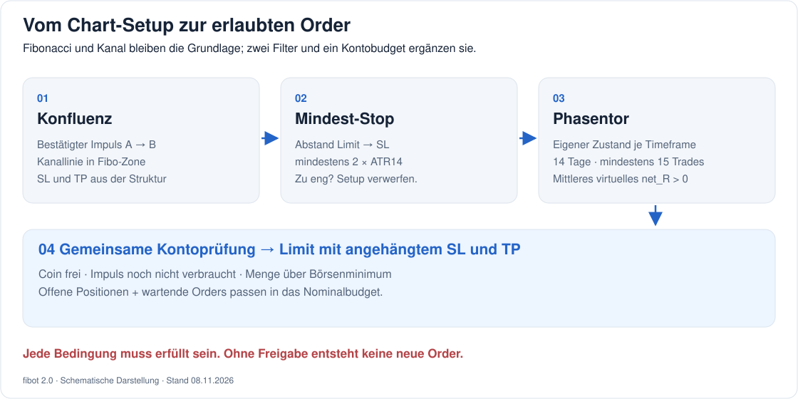
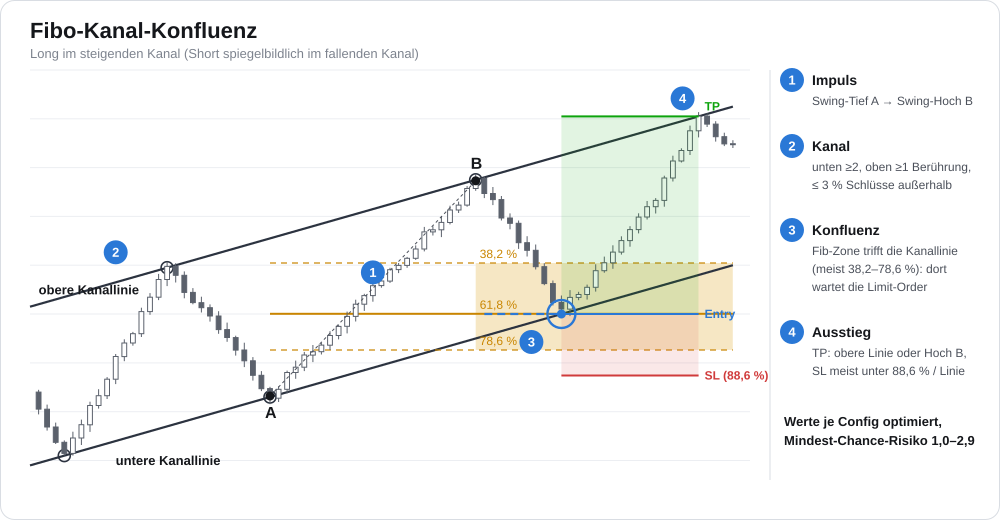
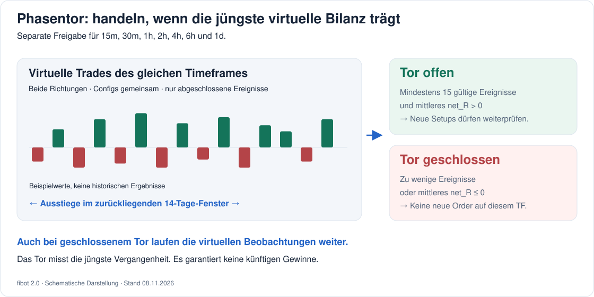
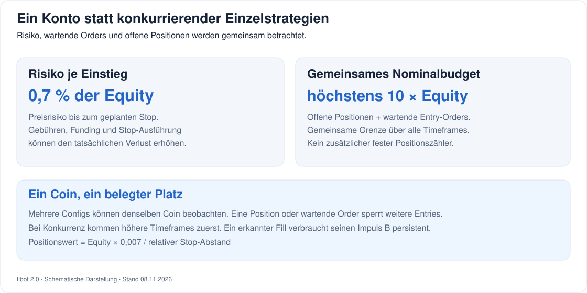

# fibot 2.0 — Fibo-Kanal-Konfluenz mit Phasentor

Ein regelbasierter Bot für Bitget USDT-Futures. **Fibonacci und Trendkanal bestimmen den Einstieg. Ein Mindest-Stopabstand und die jüngsten virtuellen Strategieergebnisse bestimmen, ob gehandelt wird.** Ein gemeinsamer Prozess verwaltet Orders und Positionen des Kontos.

> **Stand: 08.11.2026.** Diese README beschreibt den neuen Modus `fibot2`. Er wird nur mit `live_trading_settings.strategy_mode: "fibot2"` gestartet. Im bei dieser Dokumentationsaktualisierung vorgefundenen `settings.json` war dieser Modus noch nicht gesetzt. Das ist keine Bestätigung einer VPS-Umstellung.
>
> Die bisherigen Live-Verluste werden durch technische Verbesserungen nicht rückwirkend beseitigt. Ein stabiler zukünftiger Handelsvorteil ist nicht nachgewiesen. Historische Ergebnisse und ihre Einschränkungen stehen in [FORSCHUNG.md](docs/FORSCHUNG.md).



## Die Strategie

1. **Konfluenz finden.** Der bestehende Detektor sucht bestätigte Pivots, einen Kanal und den Rücksetzer des Impulses A → B. Die projizierte Kanallinie muss in der Fibonacci-Zone liegen. Die Parameter kommen aus der jeweiligen Config.
2. **Stop-Abstand prüfen.** Der Abstand vom geplanten Limit zum strukturellen Stop muss mindestens **2 × ATR14 nach Wilder** betragen. Ein zu enges Setup wird verworfen; der Stop wird dafür nicht verschoben.
3. **Phasentor prüfen.** Der Mittelwert der jüngsten abgeschlossenen virtuellen Trades desselben Timeframes muss nach dem implementierten Kostenmodell positiv sein. Ohne genügend Ereignisse bleibt das Tor geschlossen.
4. **Konto prüfen.** Kein weiterer Entry auf einem bereits belegten Coin; offene Positionen und wartende Orders teilen sich ein gemeinsames Nominalbudget.
5. **Order legen.** Limit-Entry mit angehängtem Stop-Loss und Take-Profit. Die Regeln werden zum Beginn der jeweiligen Strategiekerze neu ausgewertet.

Shorts verwenden die gespiegelte Long-Rechnung. SL und TP bleiben strukturell: Stop hinter dem Fibo-/Kanal-Level, Ziel je Config an der gegenüberliegenden Kanallinie oder am Impulshoch/-tief B. Die Fibonacci-Zone ist **kein überall festes 61,8-%-Level**.



Das Schema zeigt die Geometrie eines Long-Setups. Verbindlich sind die Werte der jeweiligen Config. Die neue Entscheidung darüber, ob das Setup gehandelt wird, zeigt die erste Illustration.

**Kein zusätzlicher EMA200-Richtungsfilter:** `fibot2_logic.py` berechnet EMA200 für die Merkmalsverfügbarkeit; die Entry-Freigabe prüft den Stop-Abstand und das Phasentor. Auch der bisherige HTF-/Tagestrendfilter ist keine zusätzliche Freigabebedingung dieses neuen Pfads.

## So funktioniert das Phasentor



Der Bot rechnet virtuelle Konfluenz-Trades aller geladenen Configs weiter, auch wenn gerade keine reale Order erlaubt ist. Dadurch kann sich ein geschlossenes Tor auf Basis neuer Beobachtungen wieder öffnen.

| Bedingung | Implementierter Wert |
|---|---|
| Gruppierung | Je Timeframe, über dessen Configs und beide Richtungen gemeinsam |
| Rückblick | Letzte **14 Tage**, nach Ausstiegszeit |
| Mindestanzahl | **15** gültige, abgeschlossene virtuelle Ereignisse |
| Freigabe | Mittleres `net_R` **größer als null** |
| Zu wenig Daten / Mittelwert ≤ 0 | Keine neue Order auf diesem Timeframe |
| Sichtbarkeit | Erst wenn die Ausstiegskerze abgeschlossen und verfügbar ist |

`R` bezeichnet den Gewinn oder Verlust relativ zum geplanten Preisrisiko bis zum Stop. Die virtuelle Rechnung setzt 0,06 % Gebühr je Seite an und belastet Verlust-Trades zusätzlich mit 0,02 % des Positionswertes. Historisches Funding und tatsächliche Live-Ausführungsabweichungen bildet dieses Modell nicht vollständig ab.

Das Tor verwendet gültige virtuelle Ereignisse des Timeframes. Diese müssen **nicht selbst** den Mindest-Stopabstand einer realen Order erfüllen. Das Phasentor ist eine rückblickende Zustandsmessung, keine Vorhersagegarantie.

## Risiko und gemeinsame Kontosteuerung



| Regel | Aktueller Codewert |
|---|---|
| Geplantes Preisrisiko je Einstieg | **0,7 % der Equity** bis zum SL, vor Gebühren und Ausführungsabweichungen |
| Positionswert | `Equity × 0,007 / relativer Stop-Abstand` |
| Gemeinsame Obergrenze | Offene Positionen **plus wartende Orders** höchstens **10 × Equity** Nominalwert |
| Coin-Sperre | Höchstens eine reale Position beziehungsweise wartende Entry-Order je Coin |
| Börseneinstellung im neuen Pfad | Isolated Margin, angeforderter Hebel **10×** |
| Mindestgröße | Börsenminimum und mindestens **5 USDT** Positionswert |
| Priorität bei Konkurrenz | Höhere Timeframes zuerst; danach Config-Schlüssel |

Beispiel: Bei 100 USDT Equity und 2 % Stop-Abstand beträgt das geplante Preisrisiko 0,70 USDT und der ungerundete Positionswert 35 USDT. Das Nominalbudget ist keine Garantie für verfügbare Margin oder eine erfolgreiche Börsenausführung.

Die Grenzen stehen derzeit als Konstanten in `src/fibot/strategy/fibot2_logic.py`. Die alten individuellen Risiko-/Hebelangaben aus `active_strategies` steuern diesen Kontomodus nicht. `max_open_positions` ist hier ebenfalls keine zusätzliche numerische Positionsgrenze.

## Live-Ablauf

Cron startet `master_runner.py` alle **15 Minuten**. Im Modus `fibot2` startet dieser genau einen Kontoprozess und den eigenen Tagesbericht; der bisherige wöchentliche Team-Optimizer und der alte Tagescheck werden in diesem Zweig nicht gestartet.

- Wartende Orders mit dem Börsenstatus abgleichen. Ein erkannter Fill verbraucht den Impuls B persistent, auch bei Fill und Exit zwischen zwei Läufen.
- Nicht gefüllte Orders einer fälligen Config stornieren und anschließend neu planen. Offene Coins bleiben gesperrt.
- Abgeschlossene Kerzen fälliger Configs nachladen, virtuelle Ereignisse erneuern und die Timeframe-Tore berechnen.
- Neue Limits nur nach allen Prüfungen legen, jeweils mit Preset-SL und Preset-TP.
- Zustand speichern. Ein Prozess-Lock und der zuletzt bearbeitete 15-Minuten-Zeitpunkt verhindern parallele beziehungsweise doppelte reguläre Läufe.

Der erste Lauf lädt auch den Vorlauf für die virtuellen Ereignisse. Er kann deutlich länger dauern als spätere Läufe mit Kerzen-Cache. **Ein fehlendes Signal oder geschlossenes Tor bedeutet, dass keine neue Order entstehen soll.**

Die historischen Probleme und die frühere Self-Repair-Logik gehören zum [alten Einzelstrategie-Modus](docs/ALTBETRIEB.md). Sie sind keine pauschale Funktionszusage für den neuen Kontopfad.

## Dateien und Betriebsdaten

| Datei / Verzeichnis | Aufgabe |
|---|---|
| `master_runner.py` | Moduswahl und Prozessstart |
| `src/fibot/strategy/confluence_logic.py` | Bestehende Kanal-/Fibonacci-Erkennung und Orderplan |
| `src/fibot/strategy/fibot2_logic.py` | Merkmale, virtuelle Trades, Stop-Prüfung und Phasentor |
| `src/fibot/strategy/fibot2_live.py` | Gemeinsamer Live-Kontozyklus |
| `src/fibot/strategy/configs_fibot2/` | Config-Pool des neuen Modus; `5m` wird ausgeschlossen |
| `src/fibot/analysis/fibot2_backtest.py` | Portfolio-Backtest des neuen Modus |
| `fibot2_daily_report.py` | Eigener täglicher Live-vs.-Backtest-Abgleich |
| `artifacts/fibot2_state.json` | Pending-Orders, Positionen, verbrauchte Impulse und bearbeitete Kerzen |
| `artifacts/fibot2_virtual.pkl` | Virtuelle Ereignisse für die Tore |
| `artifacts/fibot2_ohlcv/` | Lokal gespeicherte Live-Kerzen |
| `artifacts/fibot2.lock` | Prozess-Lock |
| `logs/fibot2.log` | Entscheidungen und Fehler des Kontozyklus |
| `logs/fibot2_report.log` | Ausgabe des Tagesberichts |

`configs_fibot2/` ersetzt für diesen Modus die frühere Auswahl über `active_strategies`. Der Code lädt die dortigen Configs und bedient jede Zeitebene nur an ihrem Kerzenbeginn. Das Phasentor filtert anschließend nach Timeframe. `5m` passt nicht zum 15-Minuten-Cron und wird ausgeschlossen.

## Einrichtung und Moduswahl

```bash
git clone https://github.com/Youra82/fibot.git
cd fibot
chmod +x install.sh
./install.sh
cp secret.json.template secret.json
```

Bitget- und Telegram-Zugangsdaten in `secret.json` eintragen. Diese Datei gehört nicht ins Repository.

Der Schalter für den neuen Kontomodus liegt innerhalb der vorhandenen Einstellungen:

```json
{
  "live_trading_settings": {
    "strategy_mode": "fibot2"
  }
}
```

Das ist ein **Konfigurationsausschnitt**, kein Ersatz für die gesamte `settings.json`. Ohne diesen Moduswert läuft weiterhin der bisherige Einzelstrategie-Zweig. Der alternative Forschungsmodus `wick_mtf` ist eine andere Strategie und nicht fibot 2.0.

Vor einer tatsächlichen Umstellung müssen Code, Config-Pool und der Modusschalter auf dem VPS zusammenpassen. `update.sh` bewahrt VPS-Einstellungen und das bisherige Portfolio; ein Code-Update allein bestätigt daher keine Modusumstellung. Bereits offene Positionen und Orders müssen beim Betriebswechsel berücksichtigt werden.

```bash
./cron_setup.sh
# */15 * * * * cd /pfad/zu/fibot && .venv/bin/python3 master_runner.py >> logs/cron.log 2>&1
```

`master_runner.py` und `fibot2_live.py` sind echte Handels-Einstiegspunkte. Ihr manueller Aufruf ist kein Vorschau- oder Paper-Modus.

## Backtest und Prüfung

Auf dem VPS beziehungsweise unter Linux, vom Projektverzeichnis aus:

```bash
export PYTHONPATH="$PWD/src"
.venv/bin/python3 -m fibot.analysis.fibot2_backtest   --start 2026-05-10 --end 2026-11-08 --equity 34 --save artifacts/fibot2_test
```

Der Backtest verwendet den historischen lokalen Kerzen-Cache. Er berücksichtigt den Config-Zeitplan, die Coin-Sperre, das Tor, den Mindest-Stop und das gemeinsame Nominalbudget. Bei mehrdeutigen SL-/TP-Kerzen wird SL zuerst gewertet; ein TP zählt nicht schon in der Füllkerze. Backtestzahlen sind keine bestätigten Live-Ergebnisse.

Der vorhandene Paritätsprüfer wird mit einem Zeitraum und expliziten Config-Schlüsseln aufgerufen:

```bash
.venv/bin/python3 tests/fibot2_live_parity.py   2026-07-20 2026-07-26 TRUMPUSDTUSDT_15m
```

Er nutzt eine simulierte Börse und lokale Daten. Der Prüfer senkt die Mindestanzahl der Tor-Ereignisse auf **3** für die Stichprobe; daraus folgt keine umfassende Prüfung sämtlicher Produktionsparameter oder Börsenfehler. Die ältere Testsuite ist im [Altbetrieb](docs/ALTBETRIEB.md#tests) beschrieben.

## Tagesbericht und Überwachung

Der eigene Bericht läuft ab **08:00 UTC** einmal täglich, standardmäßig über sieben Tage. Er vergleicht echte Bitget-Trades mit dem Backtest auf dem vom Live-Bot gespeicherten Kerzenbestand und meldet zusätzliche beziehungsweise fehlende Trades und den aktuellen Torzustand je Timeframe.

```bash
tail -f logs/fibot2.log
tail -n 100 logs/fibot2_report.log
cat artifacts/fibot2_state.json
```

Ein manueller Bericht liest das Konto und **sendet eine Telegram-Nachricht**:

```bash
.venv/bin/python3 fibot2_daily_report.py --force --days 7
```

Der Bericht startet seine Vergleichsrechnung mit der aktuell abgefragten Equity. Er ist deshalb ein Diagnosewerkzeug für Zuordnung und Abweichungen, keine vollständige historische Kontorekonstruktion.

## Forschung, Altbetrieb und Illustrationen

- [Forschung und bisherige Ergebnisse](docs/FORSCHUNG.md)
- [Bisheriger Einzelstrategie-Modus mit Pipeline, Team-Optimizer und HTF-/Tagestrendfilter](docs/ALTBETRIEB.md)
- Neue SVG-Illustrationen reproduzieren: `python docs/make_fibot2_illustrations.py`
- Frühere Illustrationen: `python docs/make_illustrations.py`

Die Illustrationen sind schematisch. Sie zeigen Regeln und Zustände, keine gemessene oder prognostizierte Gewinnkurve.
