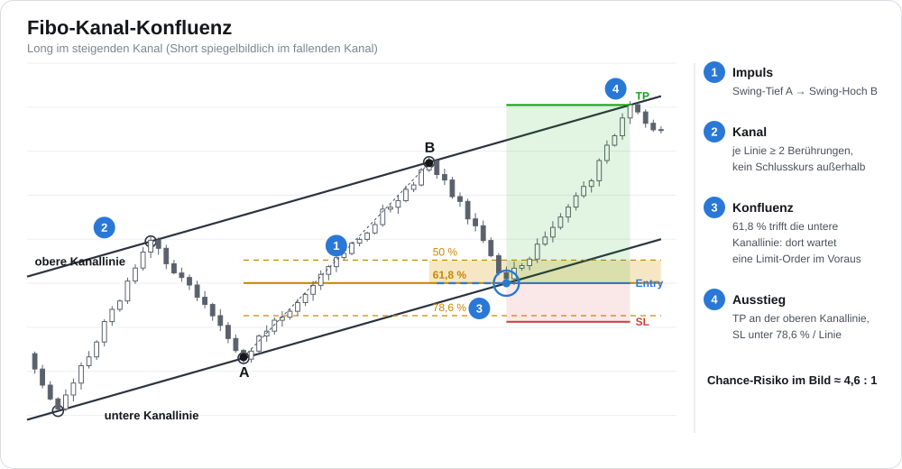
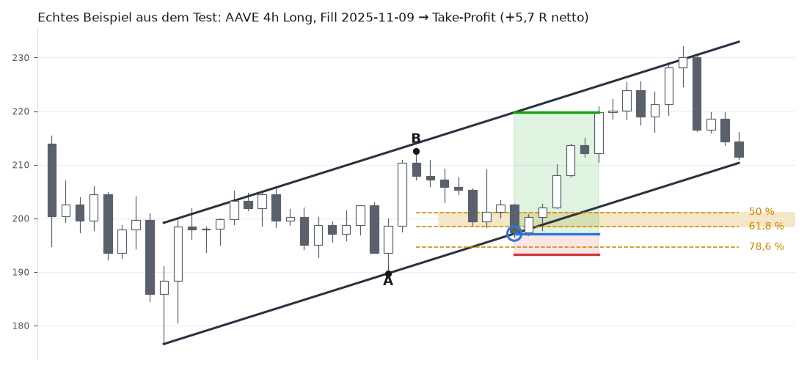
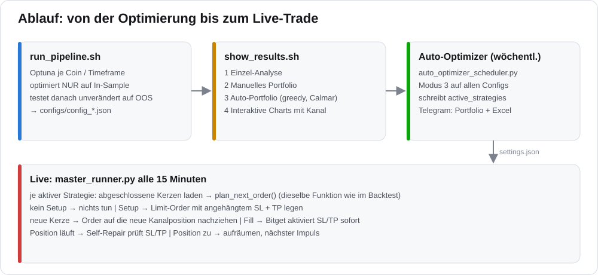
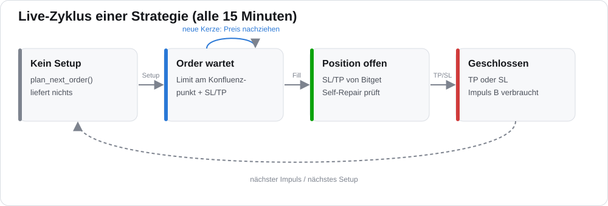
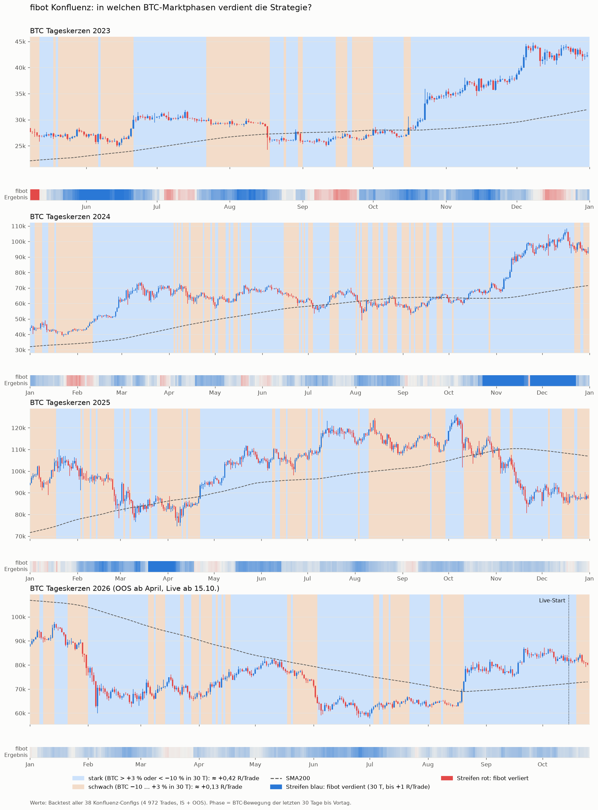
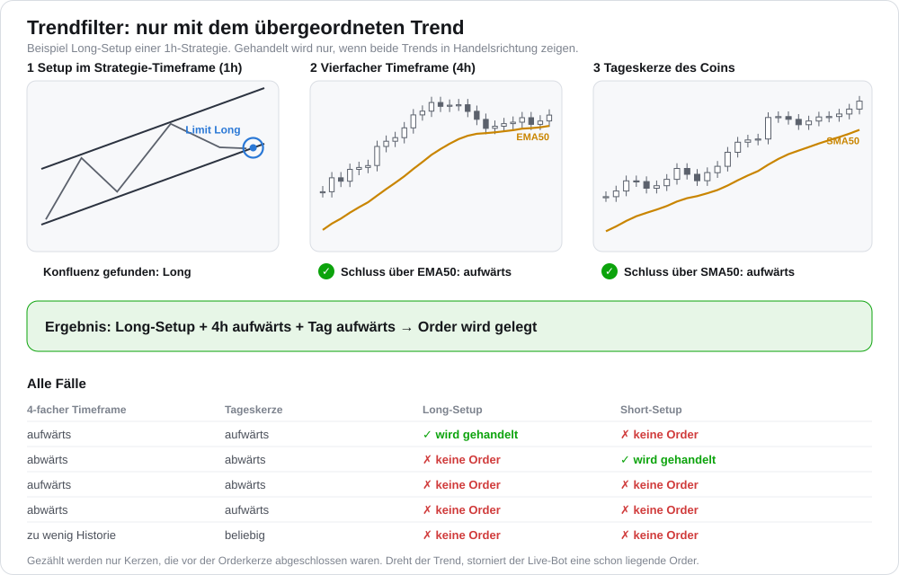
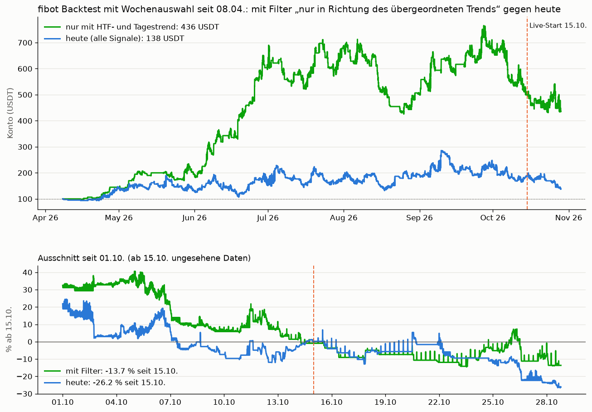

# fibot — Fibo-Kanal-Konfluenz Trading Bot

Ein regelbasierter Trading-Bot für Bitget USDT-Futures. Er macht das, was ein Chart-Trader von Hand einzeichnet:
**Impuls finden, Trendkanal ziehen, Fibonacci-Retracement darüberlegen.** Gekauft (bzw. verkauft) wird nur dort,
wo die **Kanallinie und das 61,8-%-Level zusammentreffen**. Dafür liegt die Limit-Order schon vorher an genau
diesem Punkt.

Kein maschinelles Lernen. Die Regeln sind reine Preisstruktur, und Live-Bot und Backtest benutzen dafür
**dieselbe Funktion**.

> **Disclaimer:** Experimentelle Software, ausschließlich zu Forschungszwecken. Der Handel mit Kryptowährungen
> birgt erhebliche finanzielle Risiken. Nutzung auf eigene Gefahr.

<p align="center"></p>

---

## Inhalt

- [Grundidee](#grundidee)
- [Ablauf im Überblick](#ablauf-im-überblick)
- [Strategie im Detail](#strategie-im-detail)
- [Live-Betrieb](#live-betrieb)
- [Status und Forschungsergebnisse](#status-und-forschungsergebnisse)
- [Marktphasen: wann die Strategie funktioniert](#marktphasen-wann-die-strategie-funktioniert)
- [Trendfilter: nur in Richtung des übergeordneten Trends](#trendfilter-nur-in-richtung-des-übergeordneten-trends)
- [Architektur](#architektur)
- [Konfiguration](#konfiguration)
- [Installation](#installation)
- [Workflow](#workflow)
- [Auto-Optimierung (wöchentlich)](#auto-optimierung-wöchentlich)
- [Live vs. Backtest vergleichen](#live-vs-backtest-vergleichen)
- [Tests](#tests)
- [Tägliche Verwaltung](#tägliche-verwaltung)
- [Wichtige Regeln](#wichtige-regeln)

---

## Grundidee

| Schritt | Was der Bot tut | Warum |
|---|---|---|
| **1 Impuls** | letztes bestätigtes Swing-Tief **A** und das höchste Hoch **B** danach | Das ist die Bewegung, deren Rücksetzer gehandelt wird. |
| **2 Kanal** | untere Linie durch Pivot-Tiefs, obere parallel durch Pivot-Hochs | Dort haben Käufer bzw. Verkäufer schon mehrfach reagiert. |
| **3 Konfluenz** | untere Kanallinie in die Zukunft verlängern: Wann kreuzt sie die Zone 50–61,8 %? | Zwei unabhängige Unterstützungen an einem Preis. |
| **3b Trendfilter** | nur handeln, wenn der 4-fache Timeframe **und** die Tageskerze des Coins in Handelsrichtung zeigen | Ein Rücksetzer mit dem übergeordneten Trend prallt eher ab ([Details](#trendfilter-nur-in-richtung-des-übergeordneten-trends)). |
| **4 Order** | Limit-Order **vorab** an diesem Preis, SL und TP direkt angehängt | Einstieg am Level statt irgendwo in der Zone. |
| **5 Ausstieg** | TP an der oberen Kanallinie, SL unter 78,6 % bzw. unter der Linie | Strukturell begründet, typisch 2–5 R Chance-Risiko |

Short-Setups laufen spiegelbildlich im fallenden Kanal. Technisch rechnet der Bot die Long-Logik auf der
gespiegelten Kursreihe (Preis → −Preis), damit beide Seiten garantiert dieselben Regeln haben.

<p align="center"></p>

---

## Ablauf im Überblick

<p align="center"></p>

1. **`run_pipeline.sh`** sucht per Optuna die Parameter je Coin und Timeframe. Optimiert wird **nur auf dem
   In-Sample-Zeitraum**. Danach wird die Config unverändert auf dem Out-of-Sample-Zeitraum getestet, und
   beide Ergebnisse stehen in der Config.
2. **`show_results.sh`** bietet Einzel-Analyse, manuelles Portfolio, automatisches Portfolio und interaktive
   Charts mit eingezeichnetem Kanal.
3. **Auto-Optimizer** stellt einmal pro Woche aus allen Configs das beste Team zusammen und schreibt es in
   `settings.json`.
4. **Live:** `master_runner.py` läuft alle 15 Minuten und führt jede aktive Strategie aus.
5. **Tagesbericht:** Einmal täglich vergleicht `daily_live_vs_backtest_check.py` jeden Live-Trade mit dem
   Backtest und schickt das Ergebnis per Telegram.

Der [Trendfilter](#trendfilter-nur-in-richtung-des-übergeordneten-trends) wirkt in allen fünf Schritten gleich.

---

## Strategie im Detail

Code: [`src/fibot/strategy/confluence_logic.py`](src/fibot/strategy/confluence_logic.py)

### 1 — Pivots ohne Blick in die Zukunft

Ein Hoch/Tief ist ein Pivot, wenn es das Extrem über ±`pivot_k` Kerzen ist. Benutzt wird es erst,
**nachdem** die `pivot_k` Kerzen rechts davon abgeschlossen sind. Kein Pivot „weiß“ also von späteren Kursen.

### 2 — Kanalerkennung (für jede Kerze neu)

Im Fenster der letzten `window` Kerzen werden alle Paare steigender Pivot-Tiefs als untere Linie getestet.
Eine Linie zählt nur, wenn alle folgenden Bedingungen erfüllt sind:

| Regel | Parameter | Standard |
|---|---|---|
| mindestens 2 Pivot-Tiefs liegen an der Linie | `touch_atr` | 0,3 ATR |
| Schlusskurse unter der Linie (mehr als 0,5 ATR) | `max_break_frac` | 0 % bis 3 % |
| kein Pivot-Tief deutlich darunter | `break_atr` | 0,5 ATR |
| Mindestspanne erster Anker → heute | `min_span` | 20 Kerzen |

Die **obere Linie** liegt parallel durch das relativ höchste Pivot-Hoch. Sie braucht mindestens
`min_upper_touches` eigene Berührungen und eine Mindestbreite (`min_width_atr`). Auch über ihr darf kaum ein
Schlusskurs liegen. Unter mehreren gültigen Kanälen gewinnt der mit den meisten Berührungen, bei Gleichstand
der jüngere.

### 3 — Impuls A → B

- **A** = letztes Pivot-Tief, das die untere Linie berührt.
- **B** = höchstes bestätigtes Pivot-Hoch nach A. Es muss nahe der oberen Linie liegen (`b_near_upper_atr`).
- Ein neues Hoch über B bedeutet, dass der Impuls noch läuft. Dann gibt es kein Setup.
- Ein Schlusskurs unter dem SL-Level macht B ungültig.
- **Jedes B wird höchstens einmal gehandelt.**

### 4 — Konfluenz und Limit-Order

Für die kommende Kerze wird die untere Kanallinie projiziert. Liegt dieser Preis in der Zone
`fib_hi` … `fib_lo` (Standard 61,8 % … 50 %, ± `zone_tol_atr`) und der letzte Schlusskurs darüber, liegt dort
die Limit-Order. In der nächsten Kerze ist die Linie weitergewandert, und die Order wird nachgezogen.
Optional verfällt ein Setup nach `max_age_mult` × (B − A) Kerzen.

### 5 — Stop-Loss, Take-Profit, Mindest-Chance-Risiko

| | Formel |
|---|---|
| **SL** | min(`fib_sl`-Level, Kanallinie) − `sl_buf_atr` × ATR |
| **TP** | obere Kanallinie (`tp_mode: upper`) oder Hoch B (`tp_mode: b`) |
| **Filter** | (TP − Entry) / (Entry − SL) ≥ `min_rr` |

### 6 — Konservative Backtest-Ausführung

- Gefüllt wird, wenn das Tief (Long) der Kerze den Limitpreis erreicht. Füllpreis ist der Limitpreis.
- Erreicht die **Füllkerze auch den SL**, zählt der Trade als Verlust.
- Ein TP zählt frühestens ab der nächsten Kerze.
- Berührt eine Kerze SL und TP, entscheiden Feindaten. Ohne Feindaten zählt es als Verlust.
- In der Kerze, in der ein Trade schließt, gibt es keinen neuen Fill, weil live während einer Position keine
  Entry-Order liegt.
- Gebühren: 0,06 % je Seite (Taker, konservativ).
- **PnL = Kontrakte × Kursbewegung.** Der Hebel bestimmt nur die gebundene Margin, nicht das Risiko.

---

## Live-Betrieb

<p align="center"></p>

Bei jedem Lauf (alle 15 Minuten) und für jede aktive Strategie:

1. Abgeschlossene Kerzen laden (die laufende Kerze wird verworfen). Dann ruft der Bot
   **`plan_next_order()`** auf. Das ist exakt die Rechnung, mit der der Backtest Kerze *n* plant.
2. **Kein Setup oder gegen den Trend:** Es wird keine Order gelegt. Zeigt der Trendfilter gegen das Setup,
   storniert der Bot eine schon liegende Order und meldet den Grund per Telegram. Fehlen dem Filter Daten, gibt es
   sicherheitshalber keine Order.
3. **Setup:** Der Bot legt eine Limit-Order mit **angehängtem SL und TP** (Bitget `presetStopLossPrice` /
   `presetStopSurplusPrice`). Beide aktiviert Bitget im Moment des Fills. Die Position ist also ab der ersten
   Sekunde geschützt, auch wenn der Fill zwischen zwei Läufen passiert.
4. **Neue Kerze:** Die alte Order wird storniert und auf die neue Kanalposition nachgezogen. Bei gleicher Kerze
   und gleichem Plan bleibt sie liegen.
5. **Position offen:** Self-Repair prüft SL/TP, auch in Bitgets Kategorie „Position-TP/SL“, und setzt fehlende
   Orders neu. Der Overshoot-Check schließt notfalls per Market.
6. **Geschlossen:** Der Bot räumt Rest-Orders auf. Da B laut Kerzenhistorie verbraucht ist, gibt es keinen
   zweiten Einstieg in denselben Impuls.

**Positionsgröße:** Risiko = `risk_per_entry_pct` × **Gesamtkapital**, wie im Backtest. Die Margin wird nur auf
das freie Guthaben gekappt. Positionen unter 5 USDT Notional werden nicht eröffnet.

**Aufräumen nach Portfolio-Wechsel:** Vor den Strategien storniert `master_runner.py` kontoweit Entry-Orders auf
Coins, die nicht mehr in `active_strategies` stehen. Sonst könnten sie später ohne Steuerung gefüllt werden.
SL und TP offener Positionen bleiben unberührt; die Position läuft über sie aus.

Die Parität ist getestet: [`tests/test_confluence.py`](tests/test_confluence.py) vergleicht für jede Kerze den
Live-Plan (600 Kerzen Historie) mit dem Backtest-Plan (volle Historie). Zusätzlich prüft der Test den
Live-Zyklus (legen / liegen lassen / aufräumen) mit einer Mock-Exchange.
[`tests/test_trend_filter.py`](tests/test_trend_filter.py) prüft, dass die Trendentscheidung live (nur die
zuletzt geladenen Kerzen) und im Backtest (volle Historie) auf echten Kerzen gleich ausfällt.

---

## Status und Forschungsergebnisse

Ehrlich dokumentiert, damit niemand mehr erwartet, als belegt ist:

| Test | Ergebnis |
|---|---|
| Alte Fibo-Logik (RSI-Score, Einstieg am Kerzenschluss), 63 Configs | In-Sample +0,20 R/Trade, **Out-of-Sample −0,43 R/Trade** |
| Konfluenz mit festen Lehrbuch-Parametern, v1 (10 Coins, 4h/6h/1d) | 334 Trades, **−0,09 R/Trade**, nicht bestanden |
| Konfluenz v2, strengerer Kanal (20 Coins) | 235 Trades, **−0,05 R/Trade**, brutto ≈ 0, nicht bestanden |
| BTC-Trendfilter S4 / S6 / ltbbot-Regel (17.10.2026) | gleicher R/Trade, halb so viele Trades, **schadet** |
| Wochenauswahl gegen Zufall (24.10.2026) | keine stabile Vorhersagekraft; kurze Rückblicke schaden |
| Ausstiegsregeln Einstand / Teilschluss (28.10.2026, vorregistriert) | Trefferquote bis 52 %, Ertrag −70 %, **nicht bestanden** |
| Trendfilter HTF + Tag (28.10.2026, vorregistriert) | Prüfzeitraum +0,39 statt +0,25 R/Trade, **bestanden, aktiv**; vor April umgekehrt |

Vorregistrierungen, Code und Trades: [`forschung/konfluenz/`](forschung/konfluenz/) ([`PREREG.md`](forschung/konfluenz/PREREG.md))
und [`forschung/trendfilter/`](forschung/trendfilter/).

**Stand 28.10.2026:** 38 Coin/Timeframe-Configs erfüllen im Out-of-Sample ab 01.04.2026 alle Kriterien
(PnL ≥ 10 %, MaxDD ≤ 30 %, ≥ 10 Trades, In-Sample positiv). Der wöchentliche Portfolio-Optimizer wählt daraus
jeden Mittwoch ein Team von meist 15 bis 20 Strategien, einen Timeframe je Coin.

**Live seit 15.10.2026:** 37 Trades, davon 5 Gewinner; Konto 58,6 → 41,1 USDT (−30 %). Der Tagesbericht findet
dabei dieselben Einstiege wie der Backtest (zuletzt 20 von 21). Der Bot handelt also korrekt; die Verluste kommen
aus der Strategie, die im Backtest im selben Zeitraum ebenso verlor. Nachgespielt seit 08.04.2026 mit
Wochenauswahl (ohne Trendfilter): +87 % bis 15.10. bei bis zu −45 % Drawdown, danach −26 %.

Mit **einem** Parametersatz für alle Coins hat die Regel bisher keine messbare Kante. Die Configs sind deshalb
**je Coin/Timeframe optimiert** und nach ihrem Out-of-Sample-Ergebnis ausgewählt. Wer so auswählt, findet auch
Zufallssieger: Die Backtest-Zahlen bis 15.10. sind geschönt, erst danach sind die Daten wirklich ungesehen.
Deshalb mit kleinem Risiko live laufen lassen und den täglichen Live-vs-Backtest-Bericht im Blick behalten.

---

## Marktphasen: wann die Strategie funktioniert

Ausgewertet wurden alle 38 Konfluenz-Configs mit ihren Backtest-Trades von 04/2023 bis 26.10.2026
(4 972 Trades, In-Sample und Out-of-Sample). Jeder Trade wurde der BTC-Marktphase am Vortag zugeordnet.



**So liest man das Bild:**

- **Kerzen:** BTC-Tageskerzen, ein Jahr pro Zeile. Blau = Tag im Plus, rot = Tag im Minus. Gestrichelt: SMA200.
- **Hintergrund:** BTC-Marktphase.
  - **Hellblau = günstig:** BTC in 30 Tagen über +3 % oder unter −10 %. Im Schnitt etwa **+0,42 R pro Trade**.
  - **Beige = ungünstig:** BTC seitwärts oder leicht fallend (−10 % bis +3 % in 30 Tagen). Nur etwa **+0,13 R pro Trade**.
- **Farbstreifen unter jedem Jahr:** Ergebnis des fibot im Backtest über die letzten 30 Tage.
  Kräftiges Blau = gut verdient, Rot = Verlust.

**R pro Trade nach BTC-Bewegung der letzten 30 Tage:**

| BTC in 30 Tagen | alle Trades | nur OOS | Trefferquote OOS |
|---|---|---|---|
| unter −10 % (Crash oder starke Korrektur) | +0,43 | +0,59 | 39 % |
| −10 bis −3 % | +0,18 | +0,17 | 27 % |
| ±3 % (seitwärts) | +0,10 | +0,03 | 28 % |
| +3 bis +10 % | +0,42 | +0,29 | 33 % |
| über +10 % (Rally) | +0,41 | +0,30 | 33 % |

**Was man sieht:**

- Die Strategie verdient vor allem, wenn BTC sich kräftig bewegt. Ob es hoch oder runter geht, ist fast egal.
  Die besten Zeiträume:
  - Nov.–Dez. 2024: Rally von 69k auf 100k.
  - März 2025: Korrektur von 97k auf 76k.
  - Juni 2023 und Mai–Juni 2025.
- Seitwärtsphasen sind die Schwachstelle, etwa Sommer 2023, Januar 2024 und August bis Oktober 2025.
  In ihnen liegen fast alle roten Stellen im Streifen.
- Bulle oder Bär ist weniger entscheidend: +0,28 bis +0,34 R pro Trade.
  - Shorts laufen in beiden Märkten gut.
  - Longs bringen im Bärenmarkt kaum etwas (+0,08 R).
- Niedrige BTC-Volatilität ist besser als hohe: +0,34 gegenüber +0,25 R pro Trade.
- Live-Start am 15.10.2026: BTC lief um 80k seitwärts bis leicht fallend, also in der ungünstigen Phase.
  Das erklärt den Drawdown der ersten Live-Wochen.

**Einschränkung:** Die Phasen wurden im Nachhinein bestimmt. Ein BTC-Trendfilter (S4/S6/ltbbot-Regel)
hat im Test geschadet. Ein Filter „nicht handeln, wenn BTC seitwärts läuft“ wäre eine neue Hypothese und
müsste erst vorab festgelegt auf ungesehenen Daten bestehen, bevor er eingebaut wird.

---

## Trendfilter: nur in Richtung des übergeordneten Trends

Seit 28.10.2026 aktiv. Ein Signal wird nur gehandelt, wenn **beide** Trends in Handelsrichtung zeigen:

- **Höherer Timeframe:** Kerzen des Strategie-Timeframes zu 4-fachen Kerzen zusammengefasst (15m → 1h, 30m → 2h,
  1h → 4h, 2h → 8h), Schluss über der EMA50 = aufwärts.
- **Tag:** Tageskerze des Coins, Schluss über der SMA50 = aufwärts.

Long nur bei beiden aufwärts, Short nur bei beiden abwärts. Gezählt werden nur Kerzen, die vor der Orderkerze
abgeschlossen waren. Fehlt Historie, gibt es keinen Trade. Live, Backtest, Optimizer, wöchentliche
Portfolio-Auswahl und Tagesbericht nutzen dieselben Funktionen (`src/fibot/strategy/trend_filter.py`).
Gegen den Trend legt der Live-Bot keine Order; eine schon liegende Order wird storniert und per Telegram gemeldet.

<p align="center"></p>

**Wirkung im Backtest mit wöchentlicher Portfolio-Auswahl:**



Nachgespielt mit wöchentlicher Portfolio-Auswahl seit 08.04.2026 (Start 100 USDT): **436 USDT mit Filter**
gegen 138 USDT ohne; seit dem Live-Start am 15.10. −14 % statt −26 %. Im vorregistrierten Test stieg der Ertrag
je Trade im Prüfzeitraum von +0,25R auf +0,39R, die Trefferquote von 32 auf 36 %.

**Vorbehalt:** Vor April 2026 wirkte der Filter umgekehrt (Trades gegen den Trend waren dort besser), und ein
großer Teil des Vorsprungs stammt aus dem Juni 2026. Ergebnisse, Vorregistrierung und Skripte:
[`forschung/trendfilter/`](forschung/trendfilter/).

Schalter in `settings.json`:

```json
"trend_filter": { "enabled": true, "htf_mult": 4, "htf_ema": 50, "daily_sma": 50 }
```

Fehlt der Block, ist der Filter an.

---

## Architektur

```
fibot/
├── master_runner.py                 # Cron-Orchestrator: räumt alte Orders auf, startet alle aktiven Strategien
├── auto_optimizer_scheduler.py      # wöchentliche Portfolio-Optimierung im Hintergrund
├── daily_live_vs_backtest_check.py  # täglicher Live-vs-Backtest-Bericht per Telegram
├── show_team_history.py             # welches Team wann aktiv war
├── run_pipeline.sh                  # Optuna-Optimierung (In-Sample) + OOS-Test je Coin/TF
├── show_results.sh                  # Ergebnis-Menü (4 Modi)
├── run_analysis.sh                  # 12 Analysen (Signifikanz, Monte Carlo, Regime/S6, …)
├── show_chart.py                    # aktuelles Konfluenz-Chart per Telegram
├── push_configs.sh                  # Configs + settings.json ins Repo pushen
├── update.sh                        # VPS-Update (sichert secret.json, VPS-Configs, Portfolio)
├── cron_setup.sh                    # Cron alle 15 Minuten
├── settings.json                    # aktive Strategien + Auto-Optimizer
│
├── docs/                            # README-Illustrationen (make_illustrations.py)
├── forschung/konfluenz/             # Vorregistrierung, Tests, Strategiesuche
├── forschung/trendfilter/           # Trendfilter + Ausstiegsregeln: Vorregistrierung, Ergebnis, Skripte
├── daten/compare_live_vs_backtest.py
│
└── src/fibot/
    ├── strategy/
    │   ├── confluence_logic.py      # KERN: Pivots, Kanal, Impuls, Konfluenz, plan_next_order()
    │   ├── trend_filter.py          # Trendfilter HTF + Tag (geteilt von Live, Backtest, Optimizer)
    │   ├── signals.py               # Verteiler: strategy.type → Konfluenz- oder alte Fibo-Logik
    │   ├── fibonacci_logic.py       # alte Fibo-Logik (für Altkonfigs)
    │   ├── run.py                   # Einstieg für eine Strategie
    │   └── configs/                 # config_<SYMBOL>_<TF>_fib.json
    ├── analysis/
    │   ├── backtester.py            # Einzel-Backtest (Signale über signals.py)
    │   ├── optimizer.py             # Optuna: optimize_confluence() mit IS/OOS-Trennung
    │   ├── portfolio_simulator.py   # gemeinsames Kapital, Margin-Check, chronologisch
    │   ├── interactive_chart.py     # Plotly-Chart mit Kanal je Trade
    │   ├── show_results.py          # Modi 1–4
    │   └── analysis_suite.py        # Analysen für run_analysis.sh
    └── utils/
        ├── exchange.py              # Bitget-Wrapper (Limit + angehängtes SL/TP, Position-TP/SL)
        ├── trade_manager.py         # Live-Zyklus inkl. confluence_cycle() und Trendfilter-Prüfung
        ├── team_history.py          # Teamhistorie für den Tagesbericht
        ├── confluence_chart.py      # Chart für Telegram und show_chart.py
        └── telegram.py
```

---

## Konfiguration

### `settings.json`

```json
{
  "live_trading_settings": {
    "max_open_positions": 8,
    "active_strategies": [
      { "symbol": "NEAR/USDT:USDT", "timeframe": "1h", "leverage": 5,
        "margin_mode": "isolated", "risk_per_entry_pct": 1.0, "active": true }
    ]
  },
  "optimization_settings": {
    "enabled": true,
    "start_capital": "auto",
    "objective": "pnl",
    "start_date": "oos",
    "end_date": "auto",
    "constraints": { "max_drawdown_pct": 30 },
    "send_telegram_on_completion": true,
    "schedule": { "day_of_week": 2, "hour": 3, "minute": 0,
                  "interval": { "value": 7, "unit": "days" } }
  },
  "trend_filter": { "enabled": true, "htf_mult": 4, "htf_ema": 50, "daily_sma": 50 },
  "live_vs_backtest_check_settings": { "enabled": true, "rolling_window_days": 7, "send_hour": 8 }
}
```

`active_strategies` schreibt normalerweise der Auto-Optimizer, bzw. `show_results.sh` Modus 3 auf Nachfrage.

| Einstellung | Wirkung |
|---|---|
| `start_capital: "auto"` | Der Optimizer rechnet mit dem **aktuellen Kontostand** von Bitget, Fallback 100 USDT. So fallen Trades unter dem Bitget-Minimum (5 USDT) wie live weg. Alternativ eine feste Zahl. |
| `start_date: "oos"` | Jede Strategie wird ab ihrem eigenen OOS-Beginn bewertet. |
| `objective: "pnl"` | Höchstes Endkapital mit MaxDD ≤ `constraints.max_drawdown_pct`; `"calmar"` = bestes PnL/DD-Verhältnis. |
| `trend_filter.enabled` | Trendfilter an/aus für Live, Backtest, Optimizer und Tagesbericht. Fehlt der Block, ist er an. |
| `live_vs_backtest_check_settings` | Tagesbericht: an/aus, Rückblick in Tagen, Stunde (UTC) des Versands. |

`update.sh` lässt das auf dem VPS gewählte Portfolio (`active_strategies`) unangetastet. Ein neues Portfolio entsteht dort
durch den wöchentlichen Lauf oder sofort mit `.venv/bin/python3 auto_optimizer_scheduler.py --force`.

### Strategie-Config (Konfluenz)

```json
{
  "market":   { "symbol": "AAVE/USDT:USDT", "timeframe": "4h" },
  "strategy": {
    "type": "confluence",
    "pivot_k": 5, "window": 150, "touch_atr": 0.3,
    "max_break_frac": 0.0, "min_width_atr": 3.0, "min_upper_touches": 2,
    "fib_lo": 0.5, "fib_hi": 0.618, "fib_sl": 0.786,
    "zone_tol_atr": 0.25, "sl_buf_atr": 0.2, "min_rr": 1.5,
    "max_age_mult": 2.0, "b_near_upper_atr": 0.5, "tp_mode": "upper",
    "candle_limit": 600
  },
  "risk": { "leverage": 5, "risk_per_entry_pct": 1.0, "margin_mode": "isolated" },
  "_backtest": {
    "start_date": "2023-04-08", "end_date": "2026-04-01",
    "pnl_pct": 0.0, "max_drawdown": 0.0, "total_trades": 0, "win_rate": 0.0,
    "oos": { "start_date": "2026-04-01", "end_date": "2026-10-15",
             "pnl_pct": 0.0, "max_drawdown": 0.0, "total_trades": 0, "win_rate": 0.0 }
  }
}
```

| Parameter | Bereich im Optimizer | Bedeutung |
|---|---|---|
| `pivot_k` | 3 / 5 | Pivot-Bestätigung (Kerzen je Seite) |
| `window` | 100 / 150 | Kerzen für die Kanalsuche |
| `min_upper_touches` | 1 / 2 | Berührungen der oberen Linie |
| `max_break_frac` | 0 / 0,03 | erlaubter Anteil Schlusskurse außerhalb |
| `min_width_atr` | 2 / 3 | Mindestbreite des Kanals in ATR |
| `fib_lo` / `fib_hi` | 0,382–0,5 / 0,618–0,786 | Konfluenz-Zone |
| `fib_sl` | 0,786 / 0,886 / 1,0 | SL-Level (muss tiefer liegen als `fib_hi`) |
| `zone_tol_atr` | 0,1–0,8 | Toleranz um die Zone |
| `sl_buf_atr` | 0–0,6 | Puffer unter dem SL-Level |
| `min_rr` | 1,0–3,0 | Mindest-Chance-Risiko |
| `max_age_mult` | aus / 1,5 / 2 / 3 | Setup verfällt nach × (B − A) Kerzen |
| `tp_mode` | upper / b | TP an oberer Kanallinie oder an B |
| `leverage` | 3–10 | nur Margin, nicht Risiko |
| `risk_per_entry_pct` | 0,5–3,0 | Risiko pro Trade in % des Kapitals |

Configs ohne `"type": "confluence"` laufen weiter mit der alten Fibo-Logik. `update.sh` verschiebt sie beim
Wechsel nach `configs_alt_fibo/`.

---

## Installation

```bash
git clone https://github.com/Youra82/fibot.git
cd fibot
chmod +x install.sh && ./install.sh
cp secret.json.template secret.json && nano secret.json
```

```json
{
  "fibot":    { "name": "Main Account", "apiKey": "…", "secret": "…", "password": "…" },
  "telegram": { "bot_token": "…", "chat_id": "…" }
}
```

---

## Workflow

### 1. Configs erzeugen — `run_pipeline.sh`

```bash
./run_pipeline.sh
```

```
Handelspaar(e) eingeben (ohne /USDT, z.B. BTC ETH): AAVE NEAR TRX
Zeitfenster eingeben (z.B. 1h 4h): 1h 4h
Startdatum oder 'a' für Automatik [a]:          → 1280 Tage (15m/30m: 365)
Enddatum [Heute]:
OOS-Start [180 Tage vor Enddatum]:              → bis hier wird optimiert, danach nur getestet
Startkapital [100] / Trials [150] / Max Drawdown [30] / Min Win-Rate [20]
```

Am Ende schickt die Pipeline eine Telegram-Zusammenfassung aller gespeicherten Configs mit In-Sample und OOS.
✅ markiert Configs, die die strengen Kriterien erfüllen. Pro Coin/Timeframe gibt sie beide Ergebnisse aus und
speichert sie in der Config:

```
  In-Sample: PnL +88.52%  WR 24.0%  Trades 100  MaxDD 27.30%
  OOS      : PnL +19.31%  WR 29.4%  Trades 17   MaxDD 18.50%
```

Leere Eingaben bei Coin oder Timeframe brechen die Pipeline sofort ab.

### 2. Ergebnisse prüfen — `show_results.sh`

| Modus | Inhalt |
|---|---|
| **1 Einzel-Analyse** | alle Configs isoliert, Tabelle nach PnL |
| **2 Manuelles Portfolio** | Configs auswählen (`1 3 5` oder `alle`) |
| **3 Auto-Portfolio** | Greedy-Auswahl, gemeinsames Kapital, kein Coin doppelt. Ziel laut `optimization_settings.objective`: `pnl` (Standard) = höchstes Endkapital mit MaxDD ≤ Grenze, `calmar` = bestes PnL/DD-Verhältnis. Danach optional `settings.json` schreiben, Equity-Chart + Excel per Telegram |
| **4 Interaktive Charts** | Candlestick mit Entry/Exit und dem Kanal, wie er beim Fill bekannt war |

### 2b. Analysen — `run_analysis.sh`

```bash
./run_analysis.sh               # Ergebnis zusätzlich per Telegram
./run_analysis.sh --no-telegram
```

| Nr | Analyse | Frage |
|---|---|---|
| 1 | In-Sample vs. Out-of-Sample | Hält die Config, was die Optimierung versprach? |
| 2 | Bootstrap-Signifikanz | Ist R/Trade sicher über null oder Zufall? |
| 3 | Monte Carlo | Welche Drawdowns/Verluste sind bei gleicher Trefferquote realistisch? |
| 4 | Gebühren & Slippage | Wie viel Puffer gibt es bei schlechterer Ausführung? |
| 5 | Parameter-Sensitivität | Bricht das Ergebnis bei ± einer Parameterstufe ein? |
| 6 | Stabilität je Quartal | Verdient die Strategie gleichmäßig oder nur in einer Phase? |
| 7 | Long vs. Short | Welche Seite trägt? |
| 8 | Regime + Filter S6 | Wie schlägt sie sich bei BTC über/unter SMA200, mit und ohne zerobot-Filter S6? |
| 9 | Korrelation | Streuen die Strategien im Portfolio? |
| 10 | Kelly-Sizing | Passt das Risiko pro Trade zur Trefferquote? |
| 11 | Drawdown-Dauer | Wie lange dauern Durststrecken? |
| 12 | Wochentag & Tageszeit | Gibt es Zeitmuster? |
| 0 | alle nacheinander | |

Abgefragt werden: aktives Portfolio oder alle Configs, Zeitraum, Kapital. Berichte landen in `artifacts/analysis/`.

### 2c. Aktuelles Chart per Telegram — `show_chart.py`

```bash
.venv/bin/python3 show_chart.py                                    # alle aktiven Strategien
.venv/bin/python3 show_chart.py --symbol OP/USDT:USDT --timeframe 1h
```

Zeigt den aktuell erkannten Kanal und, falls es ein Setup gibt, die Limit-Order der laufenden Kerze mit SL und
TP, also genau das, was der Live-Bot gerade tun würde.

### 3. Configs ins Repo — `push_configs.sh`

Committet nur `configs/*.json` und `settings.json` und pusht auf `origin/main`.

### 4. VPS aktualisieren — `update.sh`

```bash
./update.sh
```

- Sichert `secret.json`, die VPS-eigenen Configs und das aktive Portfolio. Danach `git reset --hard origin/main`
  und Wiederherstellung.
- **Strategiewechsel:** Liegt im Repo eine Konfluenz-Config, wird sie nie von einer alten Fibo-Config des VPS
  überschrieben. Alte Fibo-Configs wandern nach `src/fibot/strategy/configs_alt_fibo/`, das Portfolio kommt dann
  aus dem Repo.

> **Einmalig beim Umstieg von der alten Fibo-Version: `./update.sh` zweimal ausführen.** Beim ersten Aufruf läuft
> noch das alte `update.sh` vom VPS. Es holt den neuen Code, spielt aber die alten Configs zurück. Erst der zweite
> Aufruf mit dem neuen `update.sh` führt die Umstellung durch. Danach reicht wieder ein Aufruf.
>
> ```bash
> ./update.sh && ./update.sh
> ls src/fibot/strategy/configs/          # nur noch Konfluenz-Configs
> python3 show_leverage.py                # aktives Portfolio prüfen
> ```

### 5. Cron

```bash
./cron_setup.sh      # */15 * * * *  master_runner.py
```

---

## Auto-Optimierung (wöchentlich)

`master_runner.py` startet bei jedem Lauf `auto_optimizer_scheduler.py` im Hintergrund. Ist die Optimierung
fällig (Zeitplan aus `settings.json`, Standard Mittwoch 03:00, Mindestabstand 7 Tage), läuft:

```
show_results.py --mode 3 --auto --from oos
  ├─ alle Configs backtesten: jede Strategie ab IHREM OOS-Beginn (_backtest.oos.start_date) bis heute
  │    (Kanal-Vorlauf wird mitgeladen, Trades zählen erst ab OOS-Beginn; ohne OOS-Angabe ab 2025-01-01;
  │     Trendfilter wie live)
  ├─ Greedy-Portfolio: objective "pnl" = max. Endkapital mit MaxDD ≤ constraints.max_drawdown_pct
  │    (Calmar-Greedy blieb früher nach 4 Strategien bei 12,7 % DD stehen, obwohl 9 bei 21,8 % DD
  │     deutlich mehr brachten — ein lokales Optimum)
  ├─ active_strategies in settings.json schreiben
  └─ Telegram: Portfolio, Equity-Chart (HTML), Trades (Excel)
```

```bash
.venv/bin/python3 auto_optimizer_scheduler.py           # prüft, ob fällig
.venv/bin/python3 auto_optimizer_scheduler.py --force   # sofort
.venv/bin/python3 run_portfolio_optimizer.py --replot   # nur Charts neu
tail -f logs/auto_optimizer.log
```

---

## Live vs. Backtest vergleichen

**Täglich automatisch:** `master_runner.py` startet `daily_live_vs_backtest_check.py` im Hintergrund. Einmal am Tag
(Standard 08:00 UTC) vergleicht er die echten Bitget-Trades der letzten 7 Tage Trade für Trade mit dem
Portfolio-Simulator und schickt eine Telegram-Nachricht mit Bild und HTML-Übersicht:

- gleiche Einstiege, fehlende und zusätzliche Trades, jeweils mit der Ursache aus dem Bot-Log
  (zum Beispiel „Trendfilter hat die Order live verhindert“ oder „zu wenig freie Margin“),
- abweichende Ausstiege, verwaiste oder doppelte SL/TP-Orders, offene Positionen ohne Stop-Loss.

Welche Strategien zu welchem Zeitpunkt aktiv waren, kommt aus der Teamhistorie
(`artifacts/db/team_history.jsonl`, `show_team_history.py`).

```bash
.venv/bin/python3 daily_live_vs_backtest_check.py --force          # sofort, nur Ausgabe
.venv/bin/python3 daily_live_vs_backtest_check.py --force --send   # sofort, mit Telegram
```

**Langer Zeitraum:**

```bash
.venv/bin/python3 daten/compare_live_vs_backtest.py --start 2026-10-01
```

Holt die geschlossenen Positionen read-only von Bitget und vergleicht sie mit einem frischen Backtest der aktiven
Configs. Ausgegeben wird die Korrelation der kumulierten Kurven und der Wochen-PnL.

---

## Tests

```bash
./run_tests.sh
```

| Test | Prüft |
|---|---|
| `tests/test_confluence.py` | Live-Plan == Backtest-Plan je Kerze, Live-Zyklus mit Mock-Exchange, API-Fehler bricht ab |
| `tests/test_trend_filter.py` | Trendfilter: kein Blick in die Zukunft, Regel, Live == Backtest auf echten Kerzen, keine Order gegen den Trend |
| `tests/test_daily_live_vs_backtest_check.py` | Tagesbericht: Zuordnung Live ↔ Backtest, Ursachen |
| `tests/test_team_history.py` | Teamhistorie |
| `tests/test_same_candle_guard.py` | kein zweiter Einstieg in derselben Kerze |
| `tests/test_fibot.py` | settings.json, Configs, Backtester-Grundfunktionen, Live-Order auf Bitget (klein) |
| `tests/test_signal_parity.py` | Parität der alten Fibo-Logik |
| `tests/test_load_ohlcv.py` | Datenladen, Cache, Lücken |

Der Live-Order-Test setzt eine echte, sehr kleine Order auf Bitget. Überspringen mit `FIBOT_SKIP_LIVE=1`.

---

## Tägliche Verwaltung

```bash
tail -f logs/cron.log
tail -n 100 logs/fibot_AAVEUSDTUSDT_4h.log
cat artifacts/tracker/fibot_AAVEUSDTUSDT_4h.json   # pending_entry / open, Limit, SL, TP, Impuls A/B
.venv/bin/python3 src/fibot/strategy/run.py --symbol AAVE/USDT:USDT --timeframe 4h
```

Telegram meldet:

| Nachricht | Wann |
|---|---|
| `KONFLUENZ-ORDER` + Chart (Kanal, Impuls A–B, Fibo-Zone, Limit, SL, TP) | einmal je neuem Impuls |
| `Limit nachgezogen alt -> neu` | bei jeder neuen Kerze, in der die Order mit der Kanallinie wandert |
| `Setup ungültig – Order storniert` | wenn Kanal, Impuls oder Zone nicht mehr gelten |
| `gegen den übergeordneten Trend (4x1h ab, Tag ab) – Order storniert` | wenn der Trendfilter eine liegende Order nicht mehr erlaubt |
| `Housekeeper: alte Entry-Order(s) außerhalb des Portfolios storniert` | nach einem Portfolio-Wechsel |
| `Live vs. Simulator` mit Bild und HTML | einmal täglich, Tagesbericht |
| `Portfolio-Optimizer GESTARTET` / `abgeschlossen` | wöchentliche Auswahl |
| `ENTRY gefüllt` | Limit wurde gefüllt, SL/TP sind aktiv |
| `Entry gefüllt und Position bereits geschlossen` | Fill und SL/TP zwischen zwei Läufen |
| `Position geschlossen` | SL oder TP ausgelöst |
| `FEHLER` / `Self-Repair` / `NOTSCHLIESSUNG` | Orderfehler, fehlende SL/TP neu gesetzt, Kurs jenseits von SL/TP |

Die Meldungen zum Nachziehen und zum Storno lassen sich mit `"telegram_order_updates": false` unter
`live_trading_settings` in `settings.json` abschalten.

---

## Wichtige Regeln

- `secret.json`, `artifacts/tracker/` und `.last_optimization_run` sind nicht in Git.
- Pro Coin nur ein Timeframe aktiv. Bitget führt Positionen pro Coin, nicht pro Timeframe.
- Neue Configs immer über `run_pipeline.sh` erzeugen und vor dem Live-Schalten mit `show_results.sh`
  (Modus 1 oder 3) prüfen.
- Risiko klein halten, bis Live-Ergebnisse den Backtest bestätigen (siehe [Status](#status-und-forschungsergebnisse)).

---

## Abhängigkeiten

```
ccxt>=4.2.0  pandas>=2.0.0  numpy>=1.24.0  scipy>=1.11.0  optuna>=3.0.0
requests>=2.31.0  plotly>=5.0.0  openpyxl>=3.1.0  matplotlib  pytest>=7.0.0
```
