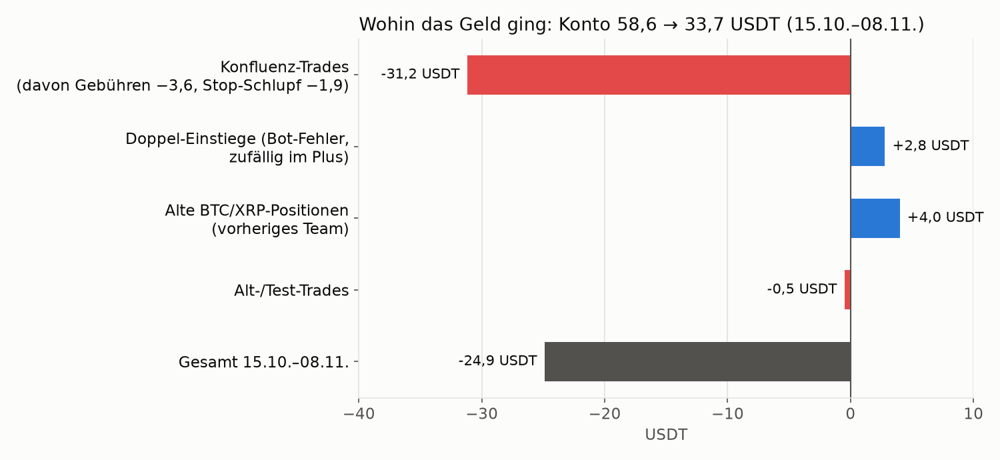
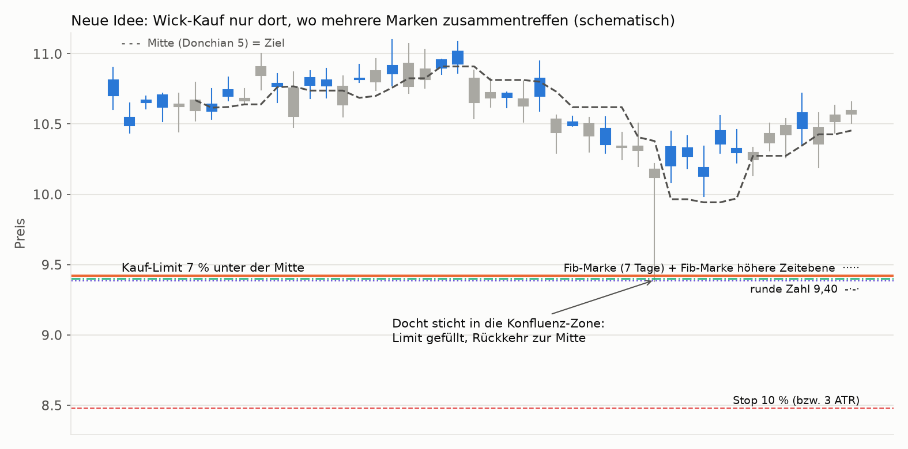
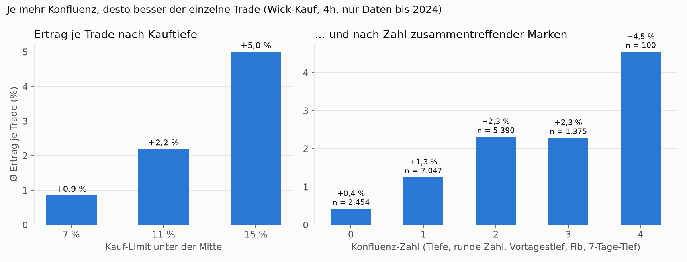
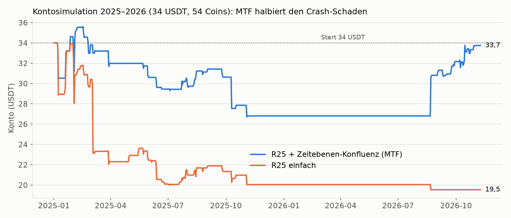
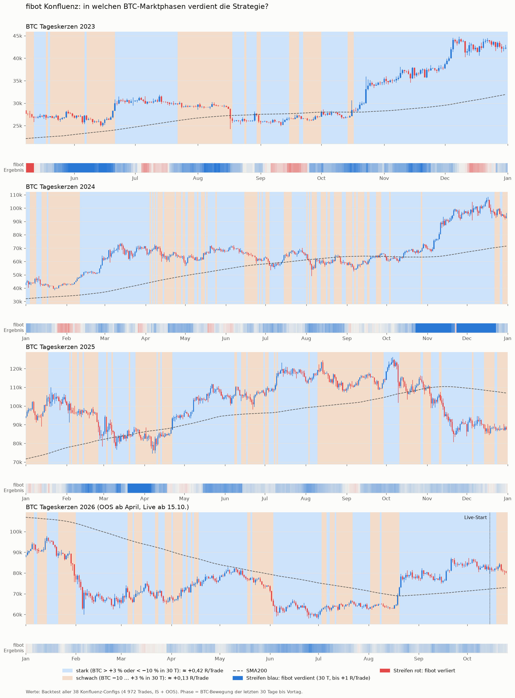
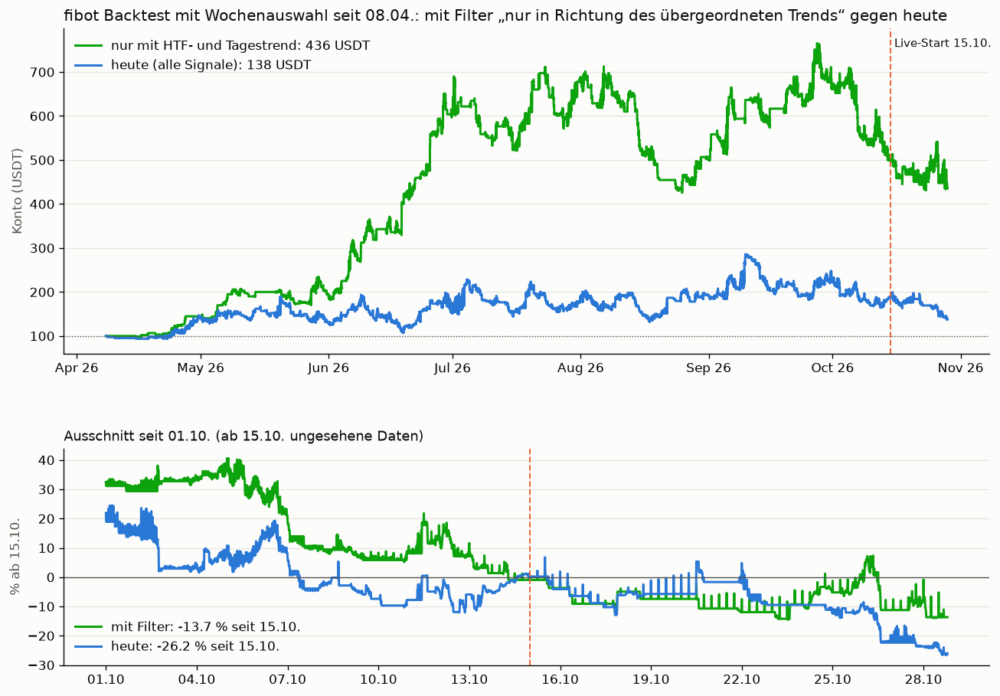

# fibot – Forschung und Tests

Hier stehen alle Untersuchungen, Backtests und vorregistrierten Tests zum fibot. Die [README](../README.md) beschreibt nur den aktuellen Live-Bot.

- [1 Forschungsstand 08.11.2026: neue Richtung](#1-forschungsstand-08112026-neue-richtung)
- [2 Frühere Forschungsergebnisse (bis 28.10.2026)](#2-frühere-forschungsergebnisse-bis-28102026)
- [3 Marktphasen: wann die Strategie funktioniert](#3-marktphasen-wann-die-strategie-funktioniert)
- [4 Trendfilter: Wirkung im Backtest](#4-trendfilter-wirkung-im-backtest)

---

## 1 Forschungsstand 08.11.2026: neue Richtung

Am 08.11.2026 wurde der fibot gemeinsam von Claude und Codex (ChatGPT) gründlich untersucht und weiterentwickelt.
Jede Regel wurde **vor** der Rechnung schriftlich festgelegt und mit Prüfsumme eingefroren, entwickelt auf einer
Hälfte der Coins bzw. auf Daten bis 2024 und erst danach auf ungesehenen Coins und 2025/26 geprüft.

### Warum das Konto seit dem 15.10. gefallen ist

- **Der Bot hat korrekt gehandelt:** 56 von 59 Live-Trades stimmen mit dem 1-Minuten-Backtest überein, meist sogar
  auf die Minute des Ausstiegs. Es ist kein Problem zu grober Backtest-Kerzen.
- **Die Konfluenz-Signale selbst haben keinen Vorteil:** 6 Gewinner aus 52 Signalen, ohne jeden Vorteil wären bei
  diesen Chance-Risiko-Verhältnissen etwa 13 zu erwarten. Über alle 407 Kandidaten der damaligen Suche liegt die
  Konfluenz auf ungesehenen Daten **vor Gebühren bei ±0 R**, nach Gebühren bei −0,15 R pro Trade.
- Die 38 „OOS-bestätigten“ Configs waren aus 407 Kandidaten **auf genau diesem Zeitraum ausgewählt**. Seit dem
  15.10. sind sie genauso schlecht wie die 369 aussortierten.
- Ein Live-Fehler: Nach Füllung und Sofort-Stop in derselben Kerze legte der nächste 15-Minuten-Lauf dieselbe Order
  erneut (Doppel-Einstiege). Diesmal zufällig im Plus, behoben wird er beim Umbau.

### Was getestet wurde

| Ansatz | Ergebnis |
|---|---|
| Konfluenz „wie ein Trader“: Bestätigungskerze, Volumen, ≥ 3 Berührungen, liquide Coins, Stop ≥ 1 % | alle negativ |
| Anderes Ziel (1 R), Teilschluss, Trailing-Ausstieg wie beim dnabot | verringert Verluste, bleibt negativ |
| Einstellungen je Config nachträglich anpassen | im Nachhinein findet man immer welche, vorher wählen geht nicht |
| Konfluenz + MERS-Reaktion (wie mbot) | 1h knapp positiv, 2026 negativ, nicht robust |
| Ausbruch-, Sweep- und Kapitulations-Regeln | durchgefallen |
| **Wick-Kauf an Fib-Marke + runder Zahl (R25)** | **bestanden** (ungesehene Coins +0,43 % je Trade, p < 0,0001) |
| **R25 + Fib-Marke der höheren Zeitebene (MTF)** | **halbiert den Crash-Schaden**, Konto-MaxDD unter 30 % |

### Der Kern, der funktioniert: Wick-Kauf an Mehrfach-Konfluenz

Statt in einem Trendkanal auf den Rücksetzer zu warten, liegt die Kauforder **tief unter der kurzfristigen Mitte**,
aber **nur dort, wo mehrere Marken zusammentreffen**: eine Fib-Marke des 7-Tage-Bereichs, eine runde Preiszahl und
eine Fib-Marke der nächsthöheren Zeitebene. Sticht ein Docht in diese Zone, wird gekauft. Das Ziel ist die Rückkehr
zur Mitte, und gehandelt wird nur, solange BTC über seiner 200-Tage-Linie liegt.

Je mehr Konfluenz am Kaufpreis zusammentrifft, desto besser ist der einzelne Trade. Tiefe Kaufstufen allein
verstärken an Crash-Tagen aber auch die Verluste, deshalb braucht es einen Crash-Schutz.

Mit der Zeitebenen-Konfluenz übersteht das Konto das Crash-Jahr 2025 mit −21 % statt −41 % und bleibt unter
30 % Drawdown. 2026 liegt es bei +26 %. Über beide Jahre zusammen steht es noch etwa bei null.

**Nächster Schritt (läuft):** Zeitebenen-Konfluenz plus Crash-Schutz, der am Crash-Tag selbst greift
(MERS-Marktbremse, Abkühlpause, Konto-Notschalter bei Stop-Häufung). Erst wenn das auf ungesehenen Daten trägt,
wird der Live-Bot umgebaut.

Unterlagen: [`forschung/untersuchung_2026_11_08/`](../forschung/untersuchung_2026_11_08/),
[`forschung/strategie_suche_2026_11_08/`](../forschung/strategie_suche_2026_11_08/),
[`forschung/mers_konfluenz_2026_11_08/`](../forschung/mers_konfluenz_2026_11_08/).

---

## 2 Frühere Forschungsergebnisse (bis 28.10.2026)

Ehrlich dokumentiert, damit niemand mehr erwartet, als belegt ist:

| Test | Ergebnis |
|---|---|
| Alte Fibo-Logik (RSI-Score, Einstieg am Kerzenschluss), 63 Configs | In-Sample +0,20 R/Trade, **Out-of-Sample −0,43 R/Trade** |
| Konfluenz mit festen Lehrbuch-Parametern, v1 (10 Coins, 4h/6h/1d) | 334 Trades, **−0,09 R/Trade**, nicht bestanden |
| Konfluenz v2, strengerer Kanal (20 Coins) | 235 Trades, **−0,05 R/Trade**, brutto ≈ 0, nicht bestanden |
| BTC-Trendfilter S4 / S6 / ltbbot-Regel (17.10.2026) | gleicher R/Trade, halb so viele Trades, **schadet** |
| Wochenauswahl gegen Zufall (24.10.2026) | keine stabile Vorhersagekraft; kurze Rückblicke schaden |
| Ausstiegsregeln Einstand / Teilschluss (28.10.2026, vorregistriert) | Trefferquote bis 52 %, Ertrag −70 %, **nicht bestanden** |
| Trendfilter HTF + Tag (28.10.2026, vorregistriert) | Prüfzeitraum +0,39 statt +0,25 R/Trade, **bestanden, aktiv**; vor April umgekehrt |

Vorregistrierungen, Code und Trades: [`forschung/konfluenz/`](../forschung/konfluenz/) ([`PREREG.md`](../forschung/konfluenz/PREREG.md))
und [`forschung/trendfilter/`](../forschung/trendfilter/).

**Stand 28.10.2026:** 38 Coin/Timeframe-Configs erfüllen im Out-of-Sample ab 01.04.2026 alle Kriterien
(PnL ≥ 10 %, MaxDD ≤ 30 %, ≥ 10 Trades, In-Sample positiv). Der wöchentliche Portfolio-Optimizer wählt daraus
jeden Mittwoch ein Team von meist 15 bis 20 Strategien, einen Timeframe je Coin.

**Live seit 15.10.2026:** 37 Trades, davon 5 Gewinner; Konto 58,6 → 41,1 USDT (−30 %). Der Tagesbericht findet
dabei dieselben Einstiege wie der Backtest (zuletzt 20 von 21). Der Bot handelt also korrekt; die Verluste kommen
aus der Strategie, die im Backtest im selben Zeitraum ebenso verlor. Nachgespielt seit 08.04.2026 mit
Wochenauswahl (ohne Trendfilter): +87 % bis 15.10. bei bis zu −45 % Drawdown, danach −26 %.

Mit **einem** Parametersatz für alle Coins hat die Regel bisher keine messbare Kante. Die Configs sind deshalb
**je Coin/Timeframe optimiert** und nach ihrem Out-of-Sample-Ergebnis ausgewählt. Wer so auswählt, findet auch
Zufallssieger: Die Backtest-Zahlen bis 15.10. sind geschönt, erst danach sind die Daten wirklich ungesehen.
Deshalb mit kleinem Risiko live laufen lassen und den täglichen Live-vs-Backtest-Bericht im Blick behalten.

---

## 3 Marktphasen: wann die Strategie funktioniert

Ausgewertet wurden alle 38 Konfluenz-Configs mit ihren Backtest-Trades von 04/2023 bis 26.10.2026
(4 972 Trades, In-Sample und Out-of-Sample). Jeder Trade wurde der BTC-Marktphase am Vortag zugeordnet.

**So liest man das Bild:**

- **Kerzen:** BTC-Tageskerzen, ein Jahr pro Zeile. Blau = Tag im Plus, rot = Tag im Minus. Gestrichelt: SMA200.
- **Hintergrund:** BTC-Marktphase.
  - **Hellblau = günstig:** BTC in 30 Tagen über +3 % oder unter −10 %. Im Schnitt etwa **+0,42 R pro Trade**.
  - **Beige = ungünstig:** BTC seitwärts oder leicht fallend (−10 % bis +3 % in 30 Tagen). Nur etwa **+0,13 R pro Trade**.
- **Farbstreifen unter jedem Jahr:** Ergebnis des fibot im Backtest über die letzten 30 Tage.
  Kräftiges Blau = gut verdient, Rot = Verlust.

**R pro Trade nach BTC-Bewegung der letzten 30 Tage:**

| BTC in 30 Tagen | alle Trades | nur OOS | Trefferquote OOS |
|---|---|---|---|
| unter −10 % (Crash oder starke Korrektur) | +0,43 | +0,59 | 39 % |
| −10 bis −3 % | +0,18 | +0,17 | 27 % |
| ±3 % (seitwärts) | +0,10 | +0,03 | 28 % |
| +3 bis +10 % | +0,42 | +0,29 | 33 % |
| über +10 % (Rally) | +0,41 | +0,30 | 33 % |

**Was man sieht:**

- Die Strategie verdient vor allem, wenn BTC sich kräftig bewegt. Ob es hoch oder runter geht, ist fast egal.
  Die besten Zeiträume:
  - Nov.–Dez. 2024: Rally von 69k auf 100k.
  - März 2025: Korrektur von 97k auf 76k.
  - Juni 2023 und Mai–Juni 2025.
- Seitwärtsphasen sind die Schwachstelle, etwa Sommer 2023, Januar 2024 und August bis Oktober 2025.
  In ihnen liegen fast alle roten Stellen im Streifen.
- Bulle oder Bär ist weniger entscheidend: +0,28 bis +0,34 R pro Trade.
  - Shorts laufen in beiden Märkten gut.
  - Longs bringen im Bärenmarkt kaum etwas (+0,08 R).
- Niedrige BTC-Volatilität ist besser als hohe: +0,34 gegenüber +0,25 R pro Trade.
- Live-Start am 15.10.2026: BTC lief um 80k seitwärts bis leicht fallend, also in der ungünstigen Phase.
  Das erklärt den Drawdown der ersten Live-Wochen.

**Einschränkung:** Die Phasen wurden im Nachhinein bestimmt. Ein BTC-Trendfilter (S4/S6/ltbbot-Regel)
hat im Test geschadet. Ein Filter „nicht handeln, wenn BTC seitwärts läuft“ wäre eine neue Hypothese und
müsste erst vorab festgelegt auf ungesehenen Daten bestehen, bevor er eingebaut wird.

---

## 4 Trendfilter: Wirkung im Backtest

**Wirkung im Backtest mit wöchentlicher Portfolio-Auswahl:**

Nachgespielt mit wöchentlicher Portfolio-Auswahl seit 08.04.2026 (Start 100 USDT): **436 USDT mit Filter**
gegen 138 USDT ohne; seit dem Live-Start am 15.10. −14 % statt −26 %. Im vorregistrierten Test stieg der Ertrag
je Trade im Prüfzeitraum von +0,25R auf +0,39R, die Trefferquote von 32 auf 36 %.

**Vorbehalt:** Vor April 2026 wirkte der Filter umgekehrt (Trades gegen den Trend waren dort besser), und ein
großer Teil des Vorsprungs stammt aus dem Juni 2026. Ergebnisse, Vorregistrierung und Skripte:
[`forschung/trendfilter/`](../forschung/trendfilter/).
